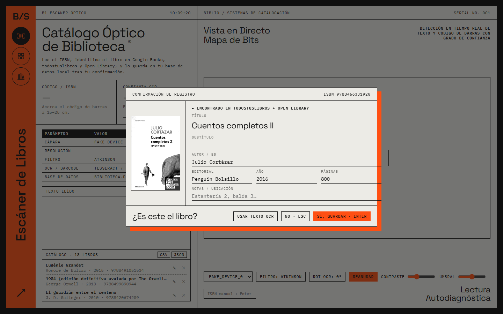
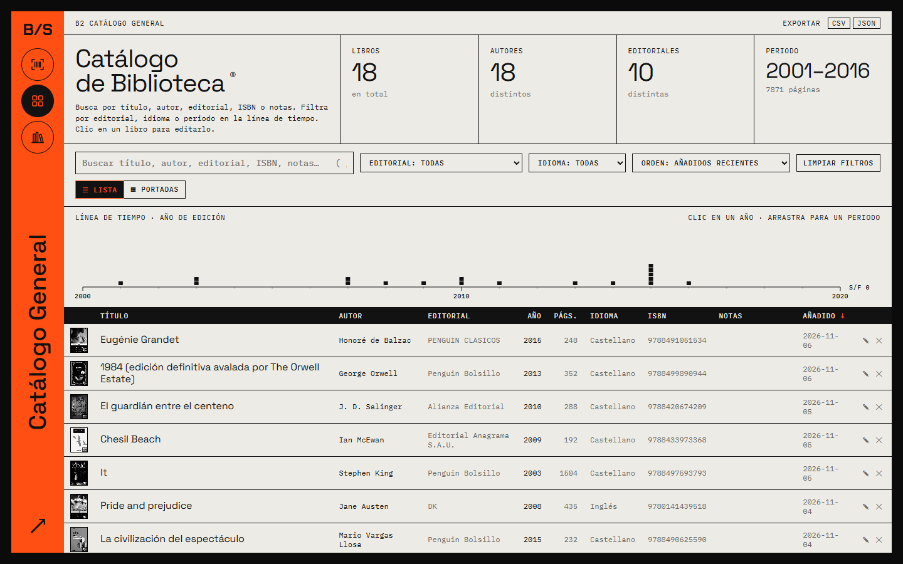
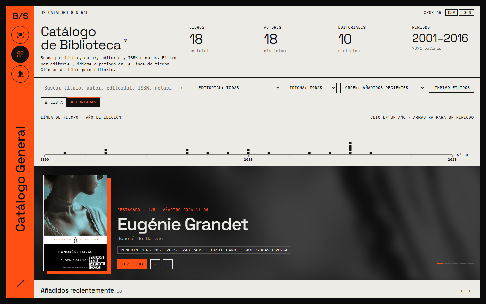
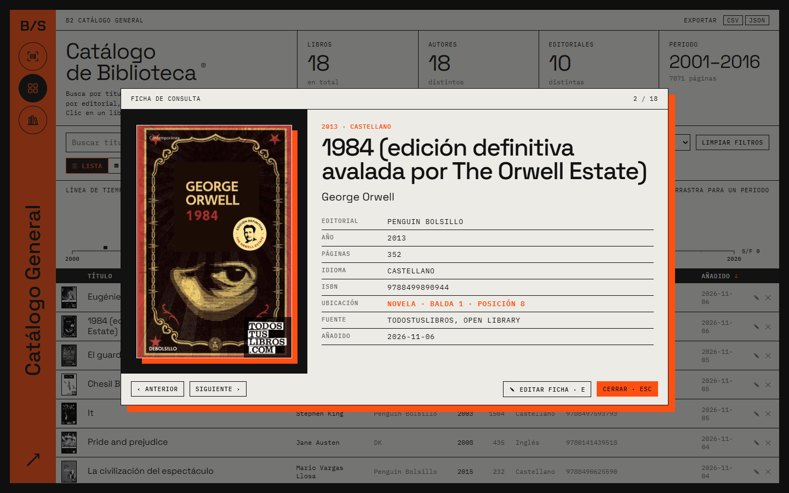
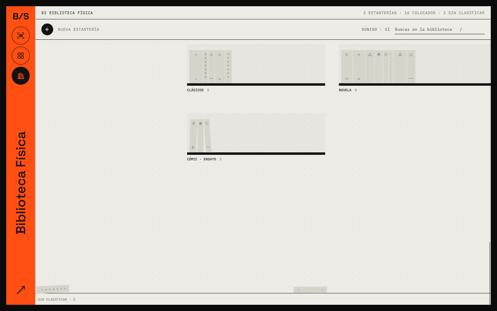

# BIBLIO / SCAN

**Catálogo óptico para tu biblioteca personal.** Apunta la webcam al código de barras de un libro y BiblioScan lee el ISBN, busca la ficha en **Google Books**, **todostuslibros** (catálogo de las librerías españolas) y **Open Library**, y la guarda en una base de datos SQLite local cuando la confirmas. Después puedes explorar el catálogo, filtrarlo y colocar cada libro en tus estanterías reales.



- 📷 **Escáner por cámara**: lee códigos de barras (ZXing) y texto (Tesseract OCR) en directo.
- 🔎 **Búsqueda en tres fuentes a la vez**, combinadas. Para los ISBN españoles (978-84…) tiene prioridad todostuslibros.
- 🗂️ **Catálogo** con buscador, filtros por editorial e idioma, línea de tiempo por año y vista de portadas.
- 📚 **Biblioteca física**: dibuja tus estanterías y arrastra cada libro a su balda.
- 💾 **Todo en local**: un único archivo `biblioteca.db`. Se exporta a CSV (Excel) o JSON.
- 🤖 **Conector MCP** de solo lectura para preguntar a Claude por tu biblioteca.

---

## Índice

1. [Instalación](#instalación)
2. [Guía de uso](#guía-de-uso)
   - [Escanear libros](#1-escanear-libros)
   - [Catálogo](#2-catálogo)
   - [Biblioteca física](#3-biblioteca-física)
   - [Exportar y copias de seguridad](#4-exportar-y-copias-de-seguridad)
   - [Atajos de teclado](#atajos-de-teclado)
3. [App para Android](#app-para-android)
4. [Conector MCP para Claude](#conector-mcp-para-claude)
5. [Configuración avanzada](#configuración-avanzada)
6. [Estructura del proyecto](#estructura-del-proyecto)

---

## Instalación

Hay tres formas de usarlo en el ordenador, de más fácil a más flexible. Para el móvil, consulta [App para Android](#app-para-android).

### A. Ejecutable para Windows (sin instalar nada)

1. Descarga `BiblioScan.exe` de la página de [Releases](../../releases).
2. Ponlo en una carpeta propia, por ejemplo `Documentos\BiblioScan\`, y ábrelo.
3. La primera vez se crea `biblioteca.db` **junto al .exe**. Ahí quedan todos tus libros, así que no la borres y guárdala en tus copias de seguridad.

> Necesita Microsoft Edge WebView2, que ya viene con Windows 10 y 11.

### B. En el navegador (solo Python)

Requisitos: **Python 3.8 o superior**. No hace falta ninguna librería externa.

```bash
git clone https://github.com/KMN43/biblioscan.git
cd biblioscan
python server.py
```

Abre **http://localhost:8765** en Chrome o Edge y permite el acceso a la cámara.

### C. Versión de escritorio desde el código

```bash
python -m pip install -r requirements.txt
python desktop.py
```

Abre la app en una ventana propia (puerto 8766) en lugar de una pestaña del navegador. Para generar tu propio `BiblioScan.exe`:

```bash
python -m pip install pyinstaller pillow
python build_exe.py
```

> Las librerías de OCR y de códigos de barras se cargan desde un CDN, así que **hace falta conexión a internet**, también para buscar las fichas de los libros.

---

## Guía de uso

La barra lateral naranja tiene tres pestañas: **Escáner** (tecla `1`), **Catálogo** (`2`) y **Biblioteca** (`3`).

### 1. Escanear libros

1. Elige la cámara en el desplegable de la parte inferior. La app recuerda tu elección.
2. Acerca el **código de barras de la contraportada a 15–25 cm** de la cámara. La vista en directo muestra la imagen en "mapa de bits" (1 bit) y marca lo que detecta.
3. Cuando lee un ISBN válido, busca el libro y abre la **Confirmación de registro** con portada, título, autor, editorial, año y páginas. También indica en qué fuentes lo ha encontrado.
4. Revisa los datos, corrígelos si hace falta y añade **notas o ubicación** (por ejemplo "Prestado a Laura").
5. Pulsa **Sí, guardar** (`Enter`) o **No** (`Esc`). Si el libro no aparece en ninguna fuente, **Usar texto OCR** rellena el título y el autor con el texto leído por la cámara.

**Consejos de lectura**

| Problema | Solución |
|---|---|
| No lee el código | Mejora la luz, aleja un poco el libro o sube el **Contraste**. |
| Imagen quemada u oscura | Ajusta el **Umbral**. |
| El OCR del texto sale mal | Gira el texto con **Rot OCR** (`R`) o cambia el **Filtro** (`F`). |
| No tengo cámara o el código está dañado | Escribe el ISBN en **ISBN manual** y pulsa `Enter`. |
| Quiero congelar la imagen | **Pausa** (`Espacio`). |

Los últimos libros guardados aparecen en la lista de la izquierda, donde puedes editarlos (✎) o borrarlos (×).

### 2. Catálogo



- **Resumen** arriba: número de libros, autores y editoriales distintos y periodo de edición.
- **Buscador** (`/`): busca por título, autor, editorial, ISBN o notas. No distingue mayúsculas ni tildes.
- **Filtros** por editorial e idioma, y **orden** por fecha de alta, título, autor, año o páginas. También puedes ordenar haciendo clic en la cabecera de la tabla.
- **Línea de tiempo**: cada cuadradito es un libro según su año de edición. **Haz clic en un año** para filtrarlo o **arrastra** para elegir un periodo.
- **Vista de portadas** (`V`): un carrusel de libros destacados y filas de portadas.



Haz clic en cualquier libro para abrir su **ficha de consulta**: todos los datos, la fuente de la que salieron y su **ubicación** en tus estanterías. Con `←` y `→` pasas al libro anterior o siguiente, con `E` editas la ficha y con `Esc` la cierras.



### 3. Biblioteca física



Reproduce tus estanterías reales para saber dónde está cada libro.

1. **Crea una estantería** con el botón **+** (o `N`) y **arrastra sobre la cuadrícula** para dibujarla. Escríbele una etiqueta, por ejemplo "NOVELA", y pulsa `Enter`.
2. Los libros que aún no tienen sitio se acumulan en el montón **Sin clasificar**, en la parte inferior.
3. **Arrastra cada libro** desde el montón hasta su balda. Los lomos tienen grosor proporcional a las páginas y se pueden mover dentro de la balda o pasar a otra.
4. Puedes **redimensionar** una estantería desde su esquina para añadirle más baldas, y también renombrarla o borrarla.
5. Pasa el ratón sobre un lomo para ver de qué libro se trata. El buscador (`/`) resalta en las estanterías los libros que coinciden.
6. Muévete con la rueda del ratón, `↑` `↓`, `RePág` `AvPág`, `Inicio` y `Fin`. El botón **Sonido** activa o silencia el sonido al colocar libros.

La ubicación ("NOVELA · balda 1 · posición 8") aparece después en la ficha de cada libro.

### 4. Exportar y copias de seguridad

- **CSV**: se abre directamente en Excel, separado por `;` y con los acentos correctos.
- **JSON**: el catálogo completo con todos los campos.

Los enlaces están en la cabecera del Catálogo y en la lista del Escáner. Para hacer una **copia de seguridad completa**, incluidas las estanterías, copia el archivo `biblioteca.db`.

### Atajos de teclado

| Dónde | Tecla | Acción |
|---|---|---|
| Global | `1` `2` `3` | Escáner · Catálogo · Biblioteca |
| Escáner | `Espacio` | Pausa / reanudar la cámara |
| Escáner | `F` | Cambiar filtro de imagen |
| Escáner | `R` | Girar el texto para el OCR |
| Confirmación | `Enter` / `Esc` | Guardar / descartar |
| Catálogo | `/` | Buscar |
| Catálogo | `V` | Alternar lista / portadas |
| Ficha | `←` `→` | Libro anterior / siguiente |
| Ficha | `E` | Editar |
| Biblioteca | `N` o `+` | Nueva estantería |
| Biblioteca | `/` | Buscar en las estanterías |
| Biblioteca | `↑` `↓` `RePág` `AvPág` `Inicio` `Fin` | Desplazarse |

---

## App para Android

La misma app, adaptada a la pantalla del móvil. **Todo se guarda en el propio teléfono**: no hay cuentas ni servidor.

**Instalación**

1. Descarga `BiblioScan.apk` de la página de [Releases](../../releases) desde el móvil.
2. Ábrelo. La primera vez Android pide permiso para *instalar apps de origen desconocido*: concédeselo al navegador o al gestor de archivos.
3. Abre BiblioScan y permite el acceso a la cámara.

**Diferencias con la versión del PC**

- **Pestañas abajo** y escáner con la **cámara trasera**.
- **Biblioteca en modo baldas**: desliza **arriba o abajo** para cambiar de balda y **a los lados** para recorrer los libros. El libro central se agranda y muestra su título en el lomo; **tócalo para abrir su ficha**. El buscador salta directamente al libro. Con **Ver plano** vuelves al plano de estanterías del PC (encogido para que quepa).
- **Pestaña Datos** (icono de base de datos):
  - **Importar** tu `biblioteca.db` del PC (o un `.json`), añadiéndolo a lo que ya tienes o reemplazándolo.
  - **Exportar** a `.db`, CSV o JSON con el menú *Compartir* de Android (Drive, correo, WhatsApp…).
  - El `.db` exportado se abre tal cual con `BiblioScan.exe`: es la forma de pasar la biblioteca entre el móvil y el PC.

> Desinstalar la app borra su biblioteca. **Exporta una copia de vez en cuando.**

**Compilar la APK desde el código** (JDK 21 y SDK de Android):

```bash
cd mobile
npm install
npm run apk
```

`npm run apk` genera `mobile/android/app/build/outputs/apk/release/app-release.apk`. Para firmarla hacen falta `mobile/keystore.properties` y el archivo `.jks`, que **no están en el repositorio**. Sin ellos, `cd android && gradlew assembleDebug` genera una versión de pruebas. La capa que sustituye al servidor Python está en `mobile/src/native.js` y los estilos de móvil en `mobile/src/mobile.css`.

---

## Conector MCP para Claude

`mcp_biblioteca.py` es un servidor [MCP](https://modelcontextprotocol.io) que permite a Claude (app de escritorio o Claude Code) **consultar tu biblioteca**. Abre la base de datos en **modo solo lectura**, así que no puede modificar nada. Tampoco necesita librerías externas.

Herramientas que ofrece:

| Herramienta | Para qué |
|---|---|
| `search_books` | Buscar por texto, autor, editorial, idioma, años, estantería o datos que faltan |
| `get_book` | Ficha completa de un ISBN |
| `library_stats` | Estadísticas del catálogo |
| `list_shelves` | Estanterías y libros de cada una |
| `list_values` | Valores distintos de un campo (autores, editoriales…) |

Para añadirlo a Claude Desktop, edita `claude_desktop_config.json`:

```json
{
  "mcpServers": {
    "biblioteca": {
      "command": "python",
      "args": ["C:\\ruta\\a\\biblioscan\\mcp_biblioteca.py"],
      "env": { "BIBLIO_DB": "C:\\ruta\\a\\biblioteca.db" }
    }
  }
}
```

Para comprobar que funciona:

```bash
python mcp_biblioteca.py --test
```

Ejemplos de preguntas: *"¿Qué libros de Cortázar tengo?"*, *"¿En qué estantería está 1984?"*, *"¿Qué libros no tienen portada?"*.

---

## Configuración avanzada

Variables de entorno opcionales:

| Variable | Por defecto | Uso |
|---|---|---|
| `BIBLIO_DB` | `biblioteca.db` junto al programa | Ruta de la base de datos (útil para hacer pruebas con una copia) |
| `BIBLIO_PORT` | `8765` | Puerto del modo navegador |
| `GOOGLE_BOOKS_API_KEY` | — | Clave gratuita de Google Books |

Google Books limita las consultas anónimas y a veces responde con el error **429**. Con una clave gratuita de Google Cloud (activando la *Books API*) el límite desaparece:

```powershell
$env:GOOGLE_BOOKS_API_KEY = "tu_clave"
python server.py
```

### API local

`server.py` expone una pequeña API REST en `http://localhost:8765`:

| Método | Ruta | Descripción |
|---|---|---|
| `GET` | `/api/books` | Lista de libros (`?download=1` para descargar) |
| `POST` | `/api/books` | Guarda o actualiza un libro (JSON) |
| `DELETE` | `/api/books/<isbn>` | Borra un libro |
| `GET` | `/api/export.csv` | Exporta a CSV |
| `GET` | `/api/lookup?isbn=…` | Busca un ISBN-13 en las tres fuentes |
| `GET` / `PUT` | `/api/library` | Lee o guarda las estanterías |

---

## Estructura del proyecto

```
biblioscan/
├── index.html          # Toda la interfaz (HTML + CSS + JS en un único archivo)
├── server.py           # Servidor local + API + búsqueda de ISBN (solo librería estándar)
├── desktop.py          # Versión de escritorio con ventana propia (pywebview)
├── build_exe.py        # Genera BiblioScan.exe con PyInstaller
├── mcp_biblioteca.py   # Conector MCP de solo lectura para Claude
├── mobile/             # App de Android (Capacitor): capa local SQLite, estilos de móvil y proyecto Android
├── biblioscan.ico      # Icono de la app
├── requirements.txt    # Dependencias de la versión de escritorio
└── docs/img/           # Capturas de esta guía
```

Tu `biblioteca.db` **no se sube al repositorio** porque está en `.gitignore`.

---

<sub>Las capturas usan un catálogo de demostración. Las portadas y los datos bibliográficos proceden de Google Books, todostuslibros y Open Library.</sub>
